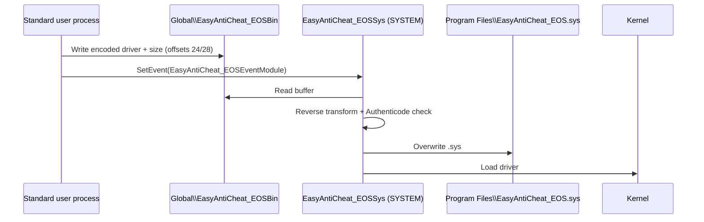

# EasyAntiCheat EOS — unprivileged signed driver rollback

A **logic flaw** in EasyAntiCheat EOS allows a **standard (non-admin) user** to choose which **older, legitimately signed** `EasyAntiCheat_EOS.sys` the **SYSTEM**-level EAC service installs and loads into the kernel. The vendor’s own service becomes the loader: it writes to the protected path under Program Files and starts the driver—without the user holding administrator privileges.

This repository packages the public research demo (`eac_poc.py`), two example driver builds (**2017** legacy and **2022**), and a screen recording. **Discovery, analysis, and the original PoC are by [azizwho](https://twitter.com/azizwho)**; this repo is a documented mirror for reproducibility and discussion.

> **Disclosure:** Reported to the vendor roughly **one year** before public release, **rejected**, and **still reproducible** at the time of publication.

---

## Table of contents

- [Demonstration](#demonstration)
- [Summary](#summary)
- [Root cause](#root-cause)
- [How the attack works](#how-the-attack-works)
- [Impact](#impact)
- [Open research](#open-research)
- [Repository layout](#repository-layout)
- [Requirements](#requirements)
- [Quick start](#quick-start)
- [Usage examples](#usage-examples)
- [Verifying success](#verifying-success)
- [Restoring the current driver](#restoring-the-current-driver)
- [Technical reference](#technical-reference)
- [Disclaimer](#disclaimer)
- [Credits](#credits)

---

## Demonstration

Screen recording showing **2022** and legacy **2017** drivers accepted, written to disk, and loaded.

<p align="center">
  <video src="https://github.com/user-attachments/assets/00000000-0000-0000-0000-000000000000" controls playsinline width="100%" />
</p>

<p align="center">
  <a href="https://github.com/itsunderscores/EAC-Rollback/blob/main/eac_poc.mp4">
    
  </a>
</p>

---

## Summary

While reversing EAC’s **driver initialization path**, the issue is not “bypass driver signing.” Windows **Authenticode** still applies. The failure is in **trust boundaries** and **policy**:

| What happens | Detail |
|--------------|--------|
| **IPC** | Driver bytes reach `EasyAntiCheat_EOSSys` through a **global shared memory** object that a **normal user can map for read/write**. |
| **No caller authentication** | The SYSTEM service **does not authenticate** which process produced the buffer—it **consumes** what appears in the section after synchronization events. |
| **Wire format** | Bytes are obscured with a **custom, reversible** transform (not encryption with integrity). Anyone who knows the algorithm can **encode** a substitute image. |
| **Policy gap** | The service checks **signature and publisher** (EasyAntiCheat / Epic) but does **not** enforce an **expected or minimum driver version**. |
| **Outcome** | An **older signed** `.sys` can be **substituted**, **written** to `Program Files (x86)\EasyAntiCheat_EOS\`, and **loaded** in ring 0—**signed-driver rollback** using EAC’s trusted loader. |

**Demo scope:** The bundled **2017** and **2022** builds illustrate downgrade; success is visible via on-disk hash match and a running `EasyAntiCheat_EOSSys` after handoff.

---

## Root cause

1. **Over-permissive DACL** on the shared section (`Global\EasyAntiCheat_EOSBin`)—documented SDDL grants **Authenticated Users** generic read/write/execute (and broad access for other principals). A low-privilege process can **modify** the same buffer the game and service use.

2. **Obfuscation ≠ authentication**—the transform protects against casual inspection only. It does **not** bind content to a trusted process, session, or minimum version.

3. **Incomplete validation after decode**—publisher signing passes for **any** still-valid historical EAC/Epic driver, enabling **rollback** to a larger kernel attack surface than the current shipping build.

---

## How the attack works



**PoC flow (`-rollback`):**

1. Wait until the EAC service is **stopped** and stale shared memory is **gone**.
2. Load the chosen **older signed** `.sys`, apply the **forward transform**.
3. User **starts an EAC-protected game**; the PoC opens the section with `FILE_MAP_READ | FILE_MAP_WRITE`.
4. Write **data length** at offset **24**, **encoded bytes** at offset **28**, signal **`Global\EasyAntiCheat_EOSEventModule`**.
5. Poll header **status** (offset **20**); compare **SHA-256** of on-disk `EasyAntiCheat_EOS.sys` to your file.

**Scan mode (`-scan`)** maps the section while a game runs, confirms user **write access**, dumps the header, and reverses the transform to recover a PE for analysis—without performing rollback.

---

## Impact

- **Signed-driver rollback without admin rights**—privilege is borrowed from the **SYSTEM** service, not from a new elevation primitive in the PoC itself.
- **Older kernel attack surface**—superseded drivers may contain bugs fixed in later builds; **further escalation** would require a **separate exploitable vulnerability** in an accepted older driver.
- **Not arbitrary code in kernel**—unsigned or wrong-publisher drivers should still **fail** signing policy; this is **downgrade**, not a universal driver loader.

---

## Open research

What happens **after** rollback is not fully mapped: how legacy drivers **initialize** against the **current** user-mode and service stack, which **IOCTL / callbacks** remain reachable, and whether any **cross-version** assumptions create additional bugs. That line of work is intentionally left for follow-on research.

---

## Repository layout

```text
.
├── README.md
├── eac_poc.py                 # Python 3 demo (-scan / -rollback)
├── eac_poc.mp4                # Full demonstration video
├── eac_poc_preview.gif        # Inline README preview (auto-generated)
└── drivers/
    ├── EAC_EOS_2017.sys       # Legacy ~2017 signed build
    └── EAC_EOS_2022.sys       # ~2022 signed build
```

---

## Requirements

- **Windows 10/11** with **EasyAntiCheat EOS** installed  
  Default driver path: `C:\Program Files (x86)\EasyAntiCheat_EOS\EasyAntiCheat_EOS.sys`
- **Python 3** (standard library only)
- An **EAC-protected title** installed (needed for timing shared memory at launch)
- **No administrator** required for the PoC process itself

Use an **isolated lab VM** or sacrificial install—not a daily-driver account.

---

## Quick start

```powershell
git clone https://github.com/itsunderscores/EAC-Rollback.git
cd EAC-Rollback

# Inspect access + in-flight driver while a game is running
python eac_poc.py -scan

# Roll back to bundled 2022 driver (read "Usage examples" first)
python eac_poc.py -rollback "drivers\EAC_EOS_2022.sys"
```

---

## Usage examples

### Help

```powershell
python eac_poc.py -h
```

### Scan shared memory (lower risk)

1. Launch any **EAC-protected** game and wait until it is running.
2. In another terminal:

```powershell
python eac_poc.py -scan
```

The tool waits for `Global\EasyAntiCheat_EOSBin`, tests mapping permissions, prints the **28-byte header**, optionally decrypts the payload to `dumped_eac_driver.sys`, and reports service state.

### Roll back to the 2017 driver

1. **Close** all EAC games; confirm `EasyAntiCheat_EOSSys` is not running (the script can wait for you).
2. Run:

```powershell
python eac_poc.py -rollback "drivers\EAC_EOS_2017.sys"
```

3. When prompted, **launch the game**. The PoC races to publish encoded bytes before the normal handshake completes.

### Roll back to the 2022 driver

Same steps, different file:

```powershell
python eac_poc.py -rollback "drivers\EAC_EOS_2022.sys"
```

### Absolute paths

```powershell
python eac_poc.py -rollback "C:\research\eac-rollback\drivers\EAC_EOS_2022.sys"
```

---

## Verifying success

The PoC prints **SHM status**, **service state**, and a disk **hash comparison**. You can double-check manually:

```powershell
certutil -hashfile "drivers\EAC_EOS_2022.sys" SHA256
certutil -hashfile "C:\Program Files (x86)\EasyAntiCheat_EOS\EasyAntiCheat_EOS.sys" SHA256
```

On success, hashes **match** and the service reports **RUNNING** after handoff.

**Service check:**

```powershell
sc query EasyAntiCheat_EOSSys
```

---

## Restoring the current driver

Before testing, copy the stock driver somewhere safe:

```powershell
copy "C:\Program Files (x86)\EasyAntiCheat_EOS\EasyAntiCheat_EOS.sys" "C:\backup\EasyAntiCheat_EOS.sys.bak"
```

To recover: stop EAC / close games, restore from backup, or **repair/reinstall** the game or EAC component from a fresh install.

---

## Technical reference

| Item | Value |
|------|--------|
| Shared section | `Global\EasyAntiCheat_EOSBin` |
| Events | `Global\EasyAntiCheat_EOSEventModule`, `Global\EasyAntiCheat_EOSEventDriver`, `Global\EasyAntiCheat_EOSEventGame` |
| Service | `EasyAntiCheat_EOSSys` |
| On-disk driver | `C:\Program Files (x86)\EasyAntiCheat_EOS\EasyAntiCheat_EOS.sys` |
| Header size | 28 bytes (LE fields: version, sizes, flags, PID, **status @20**, **length @24**) |
| Payload | Encoded driver bytes @ offset **28** |
| Status | `0` = pending, `1` = completed (PoC success heuristic) |

**SDDL (as documented in the PoC):**

```text

https://github.com/user-attachments/assets/78a931e2-c75f-45e6-a8eb-3388b9b4ef53


D:(A;OICI;GA;;;BG)(A;OICI;GA;;;AN)(A;OICI;GRGWGX;;;AU)(A;OICI;GA;;;BA)
```

**Reversible transform (simplified):** forward pass adjusts each byte using neighbors and index; the PoC’s `encrypt()` / `decrypt()` in `eac_poc.py` implement the inverse pair used on the wire.

---

## Disclaimer

This project is for **defensive security research** and **education** on systems you **own** or have **explicit permission** to test. Misuse may violate game **Terms of Service** and applicable **law**. The authors and contributors do **not** encourage cheating, unauthorized access, or deployment against production environments you do not control.

Redistributing signed driver binaries may have **license and legal** implications; ensure you comply with local law and platform policies.

---

## Credits

- **Original finding, research, and PoC:** **[azizwho](https://twitter.com/azizwho)** on Twitter/X. All credit for the vulnerability analysis and tool authorship belongs to him.
- **This repository:** Hosts the script, example drivers, demo video, and documentation for reproducibility; it is **not** a claim of independent discovery.

If you publish a fork or mirror, **keep attribution to azizwho** and link to his original disclosure.
